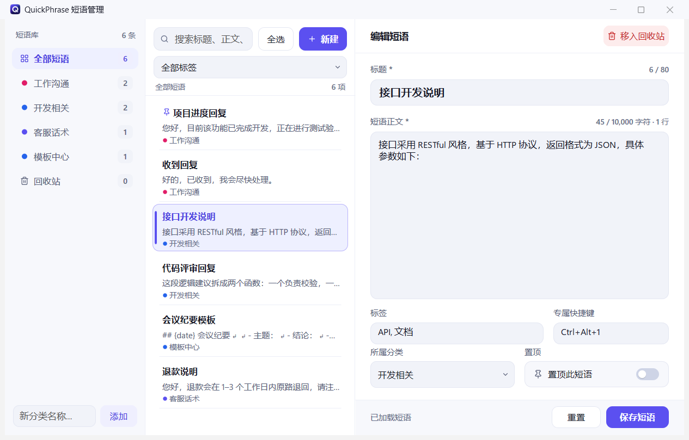
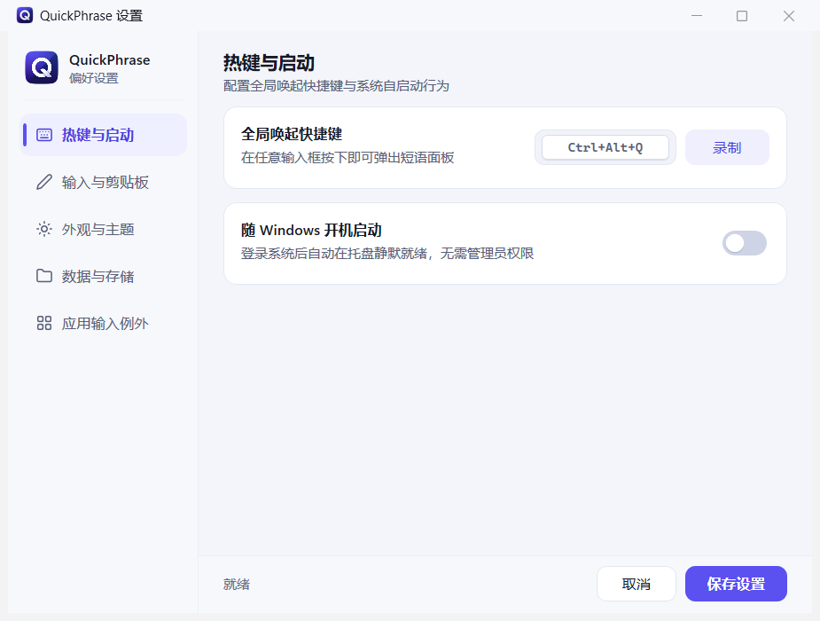

<p align="center">
  
</p>

<h1 align="center">QuickPhrase 快语</h1>

<h3 align="center">按一下，把常用话术直接打进当前窗口。</h3>

<p align="center">
  Windows 桌面全局快捷短语工具 · 全离线 · 单文件便携
</p>

<p align="center">
  <a href="https://github.com/OwOfly/QuickPhrase/releases/latest"></a>
  <a href="https://github.com/OwOfly/QuickPhrase/releases"></a>
  
  
  <a href="LICENSE"></a>
</p>

<p align="center">
  
</p>

<p align="center"><sub><code>Ctrl+Alt+Q</code> 呼出面板，搜索、回车、直接输入。目标不确定时只复制，不硬输。</sub></p>

## 为什么是 QuickPhrase

- **不打断工作流**：常驻托盘，一个热键在光标附近弹出面板，选完即输入，不用切窗口、不用找模板。
- **数据留在本机**：全离线，无账号、无网络、无遥测、无键盘钩子。
- **中文场景优先**：标题、正文、标签、拼音全拼与首字母都能搜，`tk` 就能找到“退款说明”。
- **输入有边界**：只对已验证的可编辑目标注入；终端、未知区域、超长或控制字符一律只复制。
- **带走即用**：单个 EXE，解压即运行；放一个 `portable.txt` 就变便携模式，数据跟着目录走。

## 功能

| 功能 | 说明 |
| --- | --- |
| ⚡ **全局呼出** | `Ctrl+Alt+Q` 在光标附近打开面板，可改键、可暂停；单实例，重复启动只会唤起已有窗口 |
| 🔎 **全字段检索** | 标题 / 正文 / 标签 / 拼音，支持全拼与首字母；`#标签` 语法做标签过滤 |
| 🏷️ **标签体系** | 单条最多 10 个标签；标签筛选、面板标签云、多标签 AND、按筛选结果批量添加/移除 |
| ⌨️ **短语专属快捷键** | 每条短语可绑 `Ctrl+Alt+1` 这类组合，命中后直接输入；保存时校验重复与全局热键冲突 |
| 🧩 **变量模板** | `{date}`、`{time}`、`{datetime}` 在预览中展开，插入时按当前本地时间渲染 |
| 🗂️ **三栏管理** | 分类、短语、编辑区；回收站、恢复、置顶、未保存拦截、平滑滚动 |
| 💾 **可靠的本地数据** | JSON 存储、原子写、保留 5 份备份、30 天回收站、JSON 导入/导出（合并或替换） |
| 🎒 **便携模式** | EXE 同目录放 `portable.txt`（或 `portable`），数据、备份、日志改写到 `data\` |

## 界面

### 快捷面板

浅色面板见上方大图；深色主题如下。分类与标签云在顶部，键盘全程可操作。

<p align="center">
  
</p>

### 管理短语

分类、标签、专属快捷键、回收站都在一个窗口里。

<p align="center">
  
</p>

### 设置

热键、输入与剪贴板策略、主题、开机启动、数据目录、按应用输入例外。

<p align="center">
  
</p>

## 快速开始

1. 到 [Releases](https://github.com/OwOfly/QuickPhrase/releases/latest) 下载 `QuickPhrase-0.1.1-win-x64.zip`，或直接下载单文件 `QuickPhrase-0.1.1-win-x64.exe`。
2. 解压到任意目录（单文件版可跳过），双击 `QuickPhrase.exe`。无需管理员权限。
3. 托盘出现图标后，按 `Ctrl+Alt+Q` 呼出面板。
4. 首次启动会写入几条示例短语，直接在管理窗口里改成自己的内容即可。

> 未做代码签名，Windows SmartScreen 可能提示“未知发布者”。选择“更多信息 → 仍要运行”即可。

### 常用操作

| 操作 | 说明 |
| --- | --- |
| `Ctrl+Alt+Q` | 呼出快捷面板 |
| `↑` `↓` / `Home` `End` | 在结果中移动 |
| `Enter` | 输入选中的短语（目标不确定时复制到剪贴板） |
| `Esc` | 关闭面板 |
| `Ctrl+Alt+1` | 直接输入绑定了该快捷键的短语 |
| `#标签` | 在搜索框按标签过滤；多个 `#标签` 为 AND |
| 双击托盘图标 | 打开管理窗口 |

## 数据与便携

- 默认数据目录：`%LocalAppData%\QuickPhrase`（短语、设置、备份、日志）。
- 便携模式：在 EXE 同目录放置 `portable.txt` 或 `portable`，数据改写到 `<exe>\data`。
- 升级：替换 EXE 不会动数据；只有删除数据目录才会清除短语与设置。
- 备份与恢复：设置 → 数据与存储，保留最近 5 份备份；回收站默认保留 30 天。
- 导入/导出：QuickPhrase JSON，支持“合并”与“替换”两种导入方式。

## 安全边界

QuickPhrase 的原则是**宁可只复制，也不乱输入**：

- 全离线运行，不发网络请求，不读浏览器数据，不装键盘钩子。
- 注入前快照前台窗口、进程、焦点控件与完整性级别；只在可验证的可编辑目标上使用 `SendInput`。
- 权限更高、身份不明、只读/密码框、终端多行、超长文本、控制字符：一律只写入剪贴板。
- `SendInput` 失败或目标窗口切换后**不自动重试**，避免把内容打进错误的位置。
- 日志只记录元数据，不记录短语正文；捕获诊断 JSON 仅保存在本机。

## 从源码构建

环境：Windows 10 21H2+ / Windows 11 x64、Rust nightly MSVC（当前 `nightly-2025-12-04`）、Windows SDK（`rc.exe`）。

```powershell
cargo build --release
# 产物：target\release\quickphrase.exe
```

打包发布 zip（EXE + README + LICENSE，附 SHA256）：

```powershell
powershell -NoProfile -ExecutionPolicy Bypass -File scripts\package.ps1
```

<details>
<summary><b>测试与冒烟脚本</b></summary>

```powershell
cargo test                                   # 单元测试
scripts\panel-smoke.ps1                      # 面板显示/键盘/提交
scripts\tag-batch-smoke.ps1                  # 标签筛选与批量标签
scripts\tray-smoke.ps1                       # 托盘菜单与生命周期
scripts\host-matrix.ps1                      # 跨进程输入矩阵
scripts\snippet-hotkey-smoke.ps1             # 专属快捷键直出
```

当前 0.1.1 构建：`cargo test` 150/150，fmt / clippy 通过；面板、标签批量、托盘、跨进程注入、专属快捷键冒烟全部通过。详细记录在 [`docs/reviews/`](docs/reviews/)。

</details>

<details>
<summary><b>诊断命令</b></summary>

```powershell
.\quickphrase.exe --panel-test              # 手动打开面板（Esc 退出）
.\quickphrase.exe --panel-bench             # 100 次显示/隐藏基准
.\quickphrase.exe --manage-test             # 打开管理窗口
.\quickphrase.exe --settings-test           # 打开设置窗口
.\quickphrase.exe --capture-test --delay 2000  # 抓取当前前台，报告落盘
.\quickphrase.exe --inject-test             # 注入守卫自测
.\quickphrase.exe --search-bench            # 检索基准
```

捕获报告写入 `%LocalAppData%\QuickPhrase\captures\capture-<ts>.json`，包含 UIA 元素属性、只读判定、插入点与耗时；日志在 `%LocalAppData%\QuickPhrase\logs\`。

</details>

<details>
<summary><b>技术栈与目录</b></summary>

Rust + Win32，无 WebView、无 Electron。界面用 Direct2D / DirectWrite 自绘，原生 `EDIT` / `LISTBOX` 负责输入与列表；捕获用 UI Automation + 原生控件样式双证据；输入用 `SendInput` Unicode 或剪贴板粘贴。

```
src/
  main.rs       入口与 CLI
  app.rs        主消息循环、托盘
  panel.rs      快捷面板
  manage.rs     管理窗口
  settings_ui.rs 设置窗口
  capture.rs / uia.rs   目标捕获与判定
  inject.rs     输入策略与守卫
  storage.rs    数据、备份、导入导出
  search.rs     D16 打分、排序、拼音
  theme.rs      主题令牌
docs/reviews/   各阶段验收与复核记录
scripts/        冒烟、打包、截图脚本
```

</details>

## 已知限制

- 未代码签名；SmartScreen 会提示未知发布者。
- 无安装器，采用 zip / 单文件 EXE 便携分发；卸载为退出程序后删除目录。
- 标签云只显示一行；含空格的标签需要通过管理窗口下拉或批量标签操作。
- 专属快捷键需手动输入组合，暂不提供录制控件。
- 批量标签输入是临时草稿，切换筛选或关窗不会提示保存。
- 导入/导出仅支持 QuickPhrase JSON；应用输入例外按 exe 文件名匹配，不支持通配符或窗口标题。
- 浏览器多行、终端、未知区域固定只复制；粘贴模式也受区域限制。
- 托盘气泡失败没有降级提示。

## 许可证

[MIT](LICENSE) © 2026 OwOfly

发布说明与 SHA256：[RELEASE_NOTES-v0.1.1.md](RELEASE_NOTES-v0.1.1.md)

<p align="center"><sub>如果这个工具帮到你，欢迎点个 ⭐</sub></p>